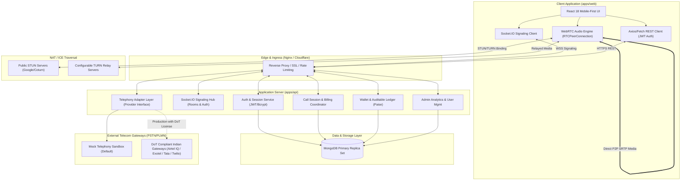
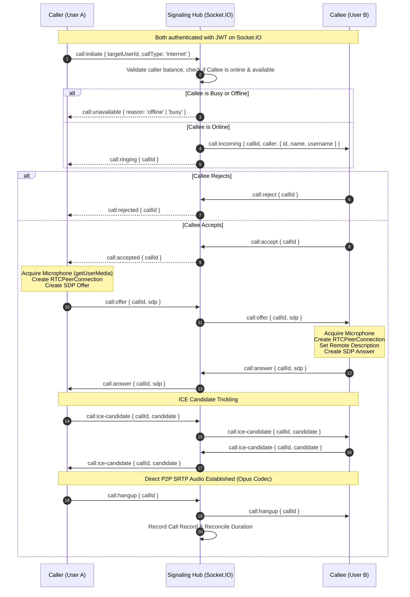
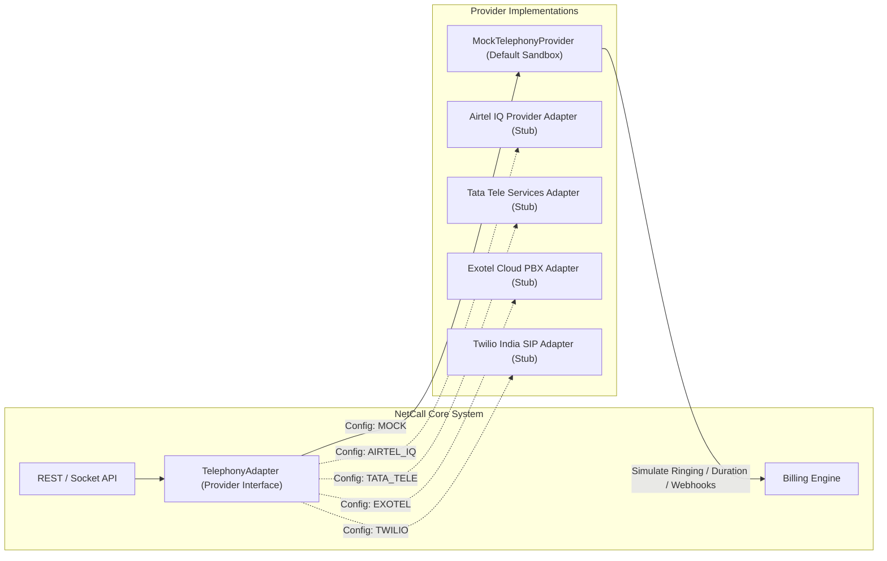
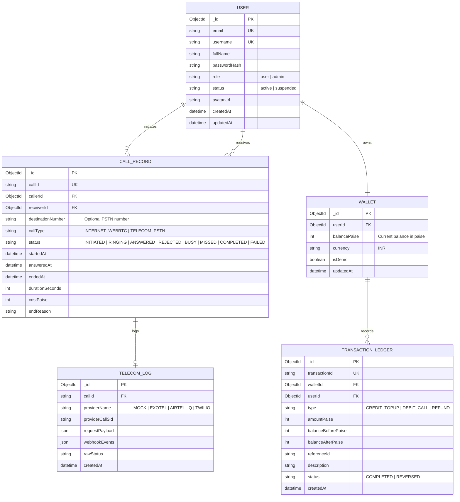

# NetCall Architecture & Technical Specification

**System Name:** NetCall Real-Time Internet & Telecom Voice Platform  
**Target Environment:** Node.js, React, WebRTC, MongoDB, Socket.IO  
**Classification:** Production-Oriented Monorepo Architecture  

---

## 1. High-Level Architecture Overview

NetCall is built around an event-driven, decoupled client-server architecture. The system separates peer-to-peer real-time media flows from transactional business logic and telecom gateways.



---

## 2. WebRTC Peer-to-Peer Voice Calling Architecture

### 2.1 Media Flow vs Signaling Flow
- **Signaling Flow (Over WebSocket/Socket.IO):** Carries session control messages (`call:initiate`, `call:offer`, `call:answer`, `call:ice-candidate`, `call:hangup`). Every message is authenticated via JWT and validated against the room membership.
- **Media Flow (Over SRTP/UDP):** Encrypted voice audio using the OPUS codec directly between peers (or relayed via TURN when symmetric NATs prevent direct hole punching). The signaling server **never** proxies or intercepts raw audio, ensuring zero audio latency and complete privacy.

### 2.2 Signaling Sequence Diagram



---

## 3. Internet-to-PSTN Telecom Bridge Architecture

### 3.1 The Regulatory Boundary in India
Under the Indian Telegraph Act, 1885, TRAI Recommendations, and DoT Guidelines:
1. **Unrestricted Internet-to-PSTN Calling is strictly controlled**: An entity cannot bridge voice packets originating from the unmanaged internet directly to an Indian mobile or landline without a Unified License (Access Service or Virtual Network Operator - VNO).
2. **Calling Line Identification (CLI) Spoofing is illegal**: Outbound calls terminating on Indian mobile networks must present an allocated, verified CLI from the telecom circle of origination.
3. **Mandatory KYC & Anti-Spam (DND/TCCCPR)**: Commercial promotional and transactional calls require Distributed Ledger Technology (DLT) entity registration (TRAI TCCCPR 2018).
4. **Implementation Mandate:** NetCall implements a provider-agnostic `TelephonyProvider` adapter. By default, it operates in a certified **Mock Sandbox Mode** with comprehensive logging, simulated carrier responses, and clear UI disclaimers.



---

## 4. Wallet, Pricing & Financial Ledger Architecture

1. **Integer Arithmetic (Paise):** To prevent floating-point rounding errors, all financial values (balances, call rates, debit/credit transactions) are strictly stored and computed in integer **paise** ($1\text{ INR} = 100\text{ paise}$).
2. **Double-Entry Style Ledger:** Every wallet mutation produces an immutable `TransactionLedger` record with:
   - `transactionId` (UUID v4)
   - `userId`
   - `type` (`CREDIT_TOPUP`, `DEBIT_CALL`, `REFUND`, `PROMOTIONAL_GRANT`)
   - `amountPaise`
   - `balanceBeforePaise`
   - `balanceAfterPaise`
   - `referenceId` (Call ID or Payment ID)
   - `status` (`COMPLETED`, `PENDING`, `FAILED`)
3. **Zero Phantom Billing Guarantee:**
   - WebRTC Internet calls: 0 paise (unlimited free voice calling).
   - PSTN calls: Billed strictly on confirmed call duration received from the provider's billable call status callback. No upfront deduction without session verification.

---

## 5. Database Schema & Data Models



---

## 6. Monorepo Structure

```
project-money/
├── apps/
│   ├── api/                     # Node.js + Express + TypeScript Backend
│   │   ├── src/
│   │   │   ├── config/          # Environment variables & constants
│   │   │   ├── controllers/     # Route request handlers
│   │   │   ├── middleware/      # Auth, RateLimiting, Validation, Error
│   │   │   ├── models/          # Mongoose DB models
│   │   │   ├── routes/          # Express route definitions
│   │   │   ├── services/        # Business logic (Auth, Wallet, Call, Admin)
│   │   │   ├── signaling/       # Socket.IO WebRTC signaling server
│   │   │   ├── telephony/       # TelephonyProvider interface & adapters
│   │   │   ├── index.ts         # Server bootstrap
│   │   │   └── app.ts           # Express app setup
│   │   ├── tests/               # Vitest + Supertest integration tests
│   │   ├── package.json
│   │   └── tsconfig.json
│   │
│   └── web/                     # React + Vite + TypeScript Frontend
│       ├── src/
│       │   ├── assets/          # Sounds, icons, graphics
│       │   ├── components/      # UI components (DialPad, CallScreen, Nav, etc.)
│       │   ├── context/         # AuthContext, CallContext, ThemeContext
│       │   ├── hooks/           # useWebRTC, useSound, useSocket
│       │   ├── pages/           # Landing, Dashboard, History, Wallet, Admin, Settings
│       │   ├── services/        # API and Socket client services
│       │   ├── types/           # Frontend-specific state types
│       │   ├── App.tsx          # Router and global layout
│       │   ├── main.tsx         # Root mount
│       │   └── index.css        # Tailwind directives & dark navy theme
│       ├── tests/               # Component & Playwright E2E tests
│       ├── package.json
│       ├── tailwind.config.js
│       └── vite.config.ts
│
├── packages/
│   └── shared/                  # Shared types, Zod schemas, DTOs
│       ├── src/
│       │   ├── types/           # Call, User, Wallet, Signaling types
│       │   ├── schemas/         # Zod schemas for auth, calls, wallet
│       │   └── constants/       # Pricing, event names, status codes
│       ├── package.json
│       └── tsconfig.json
│
├── infrastructure/              # Dockerfiles, docker-compose, coturn
│   ├── docker-compose.yml
│   ├── Dockerfile.api
│   ├── Dockerfile.web
│   └── turnserver.conf
│
├── docs/                        # Complete project documentation
│   ├── PROJECT_PLAN.md
│   ├── ARCHITECTURE.md
│   ├── TELECOM_INDIA_REGULATORY.md
│   ├── SECURITY.md
│   └── API.md
│
├── .env.example                 # Safe environment template
├── .gitignore
├── package.json                 # Monorepo root package.json
└── tsconfig.base.json           # Shared TypeScript base configuration
```

---

## 7. Security & Compliance Guardrails

1. **Zero Secret Leakage:** No JWT secrets, passwords, or provider keys are committed to Git or exposed via client-facing bundles.
2. **Access & Refresh Flow:** 15-minute access tokens with HMAC SHA-256 signing; 7-day refresh tokens securely stored in MongoDB with device fingerprints and revocation tracking.
3. **CORS & CSP:** Cross-Origin Resource Sharing strictly allows designated origins; Content Security Policy restricts audio stream sources and socket connections.
4. **Signaling Authorization:** Users can only signal peers in rooms they have been actively invited to or initiated.
5. **Rate Limiting:** IP-based and user-based sliding window rate limits protect login, registration, and call initiation endpoints against brute-force attacks and denial-of-service.
